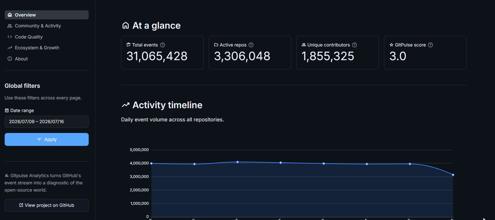
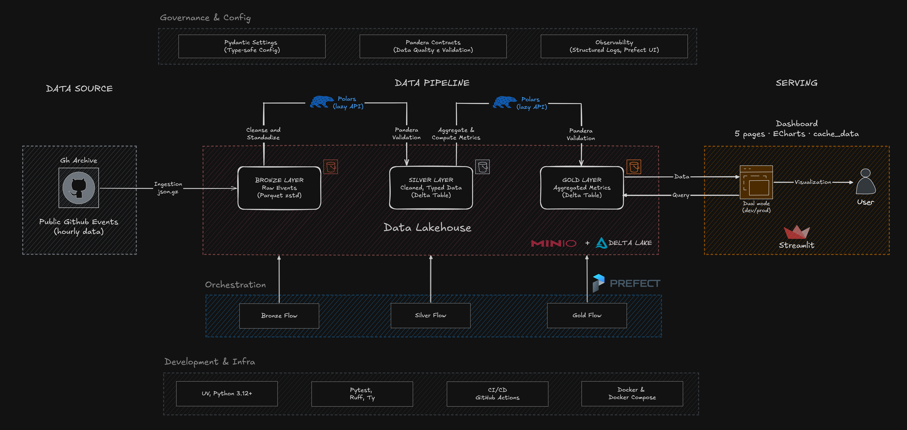

<!-- markdownlint-disable MD033 -->
<!-- markdownlint-disable MD041 -->
<div align="center">

  <!-- Badges status -->
  [](https://github.com/geogabrielp/gitpulse-analytics/actions)
  [](https://gitpulse-analytics.streamlit.app/)
  [](https://github.com/geogabrielp/gitpulse-analytics/blob/main/LICENSE)

  <!-- Wide banner -->
  

  <sub>⏳ Live demo on Streamlit Community Cloud: the first load wakes the app, so give it ~30 seconds.</sub>
</div>

---

## 🚀 Overview

Every day, millions of public GitHub events (pushes, PRs, issues, stars, forks) are generated, a goldmine of signals about developer productivity, community health, and ecosystem trends. But the raw data from [GH Archive](https://www.gharchive.org/) isn't query-ready.

**GitPulse Analytics** solves this with a Lakehouse pipeline (Bronze → Silver → Gold) that ingests, cleans, and aggregates this data into an interactive dashboard. The result? Visibility into **what the GitHub ecosystem is doing right now**: trending repos, community health, and code quality signals. All with open-source tools, running locally by default.

> **Local-first and learning-focused.** This is a personal study project: it runs on a single machine with local infrastructure, and the hosted dashboard is a read-only demo fed by a static dataset snapshot.

---

## 🎬 Demo

<p align="center">
  
  <br>
  <em>Dashboard pages: overview, community, code quality, and ecosystem.</em>
</p>

---

## 🏗️ Architecture

### Diagram

<p align="center">
  
  <br>
  <em>Data flows from GH Archive → Bronze (raw) → Silver (cleaned) → Gold (aggregated) → Dashboard.</em>
</p>

| Layer | Storage | Format | Description |
| --- | --- | --- | --- |
| **Bronze** | MinIO `bronze` | Parquet (zstd) | Raw `.json.gz` → Parquet. Immutable, partitioned by `year/month/day/hour`. |
| **Silver** | MinIO `silver` | Delta Lake | Cleaned, typed, validated with Pandera. **1 fact** (events) + **3 dimensions** (actors, repos, orgs). UTC timestamps, same partition scheme. |
| **Gold** | MinIO `gold` | Delta Lake | `daily_activity` table at `(day, repo_id, org_id)` grain with **GitPulse Score** (0–100). Partitioned by `year/month`. |

### GitPulse Score

A daily activity index (0–100) built from four weighted GitHub event types. It measures **how much** a repository did on a given day, not how healthy or important it is.

| Event | Weight | Rationale |
| ------- | -------- | ----------- |
| PushEvent | 1× | Baseline coding activity |
| WatchEvent (star) | 2× | Community interest |
| IssuesEvent | 3× | Bug tracking & discussion |
| PullRequestEvent | 5× | Collaboration & code review |

`score = min(push×1 + watch×2 + issues×3 + pr×5, 100)`

---

## 🏁 Quick Start

### Prerequisites

<table>
  <tr>
    <td><b>🐍 Python 3.12+</b></td>
    <td><a href="https://www.python.org/downloads/">python.org/downloads</a></td>
  </tr>
  <tr>
    <td><b>⚙️ make</b></td>
    <td>Built-in on macOS/Linux · <a href="https://learn.microsoft.com/en-us/windows/wsl/setup/environment">Windows (WSL)</a></td>
  </tr>
  <tr>
    <td><b>🐳 Docker & Compose</b></td>
    <td><a href="https://docs.docker.com/get-docker/">docs.docker.com/get-docker</a></td>
  </tr>
  <tr>
    <td><b>📦 uv</b></td>
    <td><a href="https://docs.astral.sh/uv/#getting-started">docs.astral.sh/uv</a> <br> <code>pip install uv</code> or <code>curl -LsSf https://astral.sh/uv/install.sh | sh</code></td>
  </tr>
</table>

### 1. Clone & install

```bash
git clone https://github.com/geogabrielp/gitpulse-analytics.git
cd gitpulse-analytics
make install         # creates .env from .env.example and syncs dependencies
```

### 2. Start infra & run pipeline

```bash
make up              # MinIO, PostgreSQL, Prefect server
make pipeline        # bronze → silver → gold (last 7 days)
```

The window and the layers are configurable:

```bash
uv run main.py --days 15         # full pipeline, 15 days
uv run main.py bronze --days 15  # only bronze
uv run main.py silver            # only pending partitions
uv run main.py gold              # only pending days
```

### 3. Launch dashboard

```bash
make dashboard       # http://localhost:8501
```

> The code default is `hf`, so the hosted demo needs no configuration. Set `hf` in `.env` to read the public snapshot locally.

### 4. Schedule the hourly pipeline (optional)

```bash
make serve           # long-running process, one run every hour at :35 UTC
```

The Prefect server must be running. Trigger a run manually with:

```bash
uv run prefect deployment run 'hourly-pipeline/gitpulse-hourly'
```

### Local services

| Service | URL |
| --- | --- |
| MinIO API | <http://localhost:9010> |
| MinIO console | <http://localhost:9011> |
| Prefect UI | <http://localhost:4200> |
| Dashboard | <http://localhost:8501> |

> 💡 Run `make help` for every command. `make down` stops the stack, `make reset` also deletes the MinIO and Postgres volumes (**destructive**).

---

## ⚙️ Configuration

`make install` copies `.env.example` to `.env` on first run (an existing `.env` is never overwritten). The file is gitignored, so credentials stay local.

| Variable | Purpose |
| --- | --- |
| `MINIO_ROOT_USER`, `MINIO_ROOT_PASSWORD` | MinIO credentials used by the pipeline and the local dashboard |
| `PREFECT_API_URL` | Prefect server API (<http://localhost:4200/api>) |
| `DASHBOARD_DATA_SOURCE` | `minio` for local development or `hf` for the public snapshot (the code default) |
| `DASHBOARD_HF_DATASET` | Hugging Face dataset read when `DASHBOARD_DATA_SOURCE=hf` |
| `DASHBOARD_CACHE_TTL` | Query cache TTL in seconds |
| `DASHBOARD_EXPORT_PATH` | Output folder for `make export-data` (gitignored) |

## ⚡ Benchmark

Clean run from `make reset` → `make up` → `uv run main.py --days 15` on a **MacBook Pro M1 Pro** (8 cores, 16 GB RAM, 8 ingestion workers).

**Workload:** 15 days of GH Archive (2026-09-29 → 2026-10-14), **381** hourly files, **24.5M** events.

| Stage | What happens | Duration | Share | Data written |
| :---: | --- | ---: | ---: | ---: |
| **Bronze** | GH Archive `.json.gz` → Parquet, 8 workers | 4m 53s | 63% | 4.6 GB |
| **Silver** | Validation, cleaning, dedup | 2m 37s | 34% | 982 MB |
| **Gold** | Daily repo metrics | 14s | 3% | 75 MB |
| | **End-to-end** | **7m 48s** | **100%** | **5.6 GB** |

> Bronze is download-bound, so its share tracks network
> throughput, silver and gold scale linearly with data volume.

---

## ✨ Dashboard Features

| Page | Highlights |
| --- | --- |
| **📈 Overview** | KPI cards (events, repos, contributors, score), daily timeline, event type distribution, top repos, stacked events |
| **👥 Community** | Bot vs. human breakdown, top contributors, contributor growth, activity heatmap × hour |
| **💻 Code Quality** | PR merge rate, PR funnel, issue close rate, review metrics (reviews & comments per PR), Score timeline |
| **📈 Ecosystem** | Org summary, trending repos, star & fork growth, stars vs. engagement analysis |

---

## 🛠️ Tech Stack

| Category | Technology | Purpose |
| --- | --- | --- |
| **Storage** | [MinIO](https://min.io/) + [Delta Lake](https://delta.io/) | S3-compatible storage, ACID transactions, time travel, schema enforcement |
| **Format** | [Apache Parquet](https://parquet.apache.org/) (zstd) | Columnar storage with high compression |
| **ETL** | [Polars](https://pola.rs/) | Lazy DataFrame API, streaming, no pandas in the ETL |
| **Validation** | [Pandera](https://pandera.readthedocs.io/) | Runtime data contracts, fast-fail on quality issues |
| **Orchestration** | [Prefect v3](https://docs.prefect.io/v3/) | Retries, monitoring, idempotent flows, hourly schedules |
| **Visualization** | [Streamlit](https://streamlit.io/) + [ECharts](https://echarts.apache.org/) | Interactive dashboard with rich chart types |
| **Public data** | [Hugging Face Datasets](https://huggingface.co/datasets/geogabrielp/gitpulse-analytics) | Parquet snapshot read by the hosted dashboard |
| **Config** | [Pydantic Settings](https://docs.pydantic.dev/latest/concepts/pydantic_settings/) | Typed, validated environment variables |
| **Infra** | [Docker Compose](https://docs.docker.com/compose/) | Local MinIO, PostgreSQL, Prefect server |
| **Deps** | [uv](https://docs.astral.sh/uv/) | Fast Python package manager |

---

## 📄 Data Source

All data comes from the **[GH Archive](https://www.gharchive.org/)**, a public dataset recording every public GitHub event since February 2015, released as hourly `.json.gz` files.

**Bronze (raw):** all event types are ingested with no filtering, every GH Archive event lands in the lake.

**Silver (cleaned):** 12 event types with analytical value are kept. 4 low-value types are explicitly excluded:

| Excluded type | Reason |
| --- | --- |
| `GollumEvent` | Wiki page changes, no analytical signal |
| `MemberEvent` | Internal membership management |
| `DiscussionEvent` | Discussions (low adoption in GH Archive) |
| `PublicEvent` | Repo visibility toggle (one-time event) |

**Tracked event types:**

`PushEvent` · `PullRequestEvent` · `IssuesEvent` · `WatchEvent` · `IssueCommentEvent` · `PullRequestReviewEvent` · `PullRequestReviewCommentEvent` · `CreateEvent` · `DeleteEvent` · `ForkEvent` · `ReleaseEvent` · `CommitCommentEvent`

---

## 📁 Project Structure

```text
gitpulse-analytics/
├── src/core/              # Business logic (orchestrator-agnostic)
│   ├── config/            # Pydantic settings for env vars
│   ├── contracts/         # Pandera schemas for bronze, silver, gold
│   ├── ingestion/         # GH Archive → Bronze
│   ├── transforms/        # Bronze → Silver, Silver → Gold
│   └── helpers/           # S3, Delta Lake, logging
├── pipelines/             # Prefect flows (thin orchestration) and the hourly flow
├── dashboard/
│   ├── app.py             # Streamlit entrypoint and navigation
│   ├── queries.py         # Cached queries over MinIO or HF Parquet
│   ├── pages/             # One module per dashboard page
│   └── components/        # Charts, KPI cards, sidebar
├── tests/                 # Pytest suite (contracts, transforms, helpers)
├── scripts/               # Export lake tables to Parquet for Hugging Face
├── infra/                 # MinIO bucket bootstrap
├── docs/images/           # Architecture diagram and demo GIF
├── main.py                # CLI entrypoint to run or serve the flows
├── docker-compose.yaml    # MinIO, PostgreSQL, Prefect server
├── Makefile               # Common commands (see `make help`)
├── pyproject.toml         # Dependencies and tool configuration
├── uv.lock                # Locked dependency graph
├── .env.example           # Configuration template
└── .github/workflows/     # CI: lint, format, types, tests
```

---

## 🧑‍💻 Development

```bash
make test        # pytest, fast-fail
make test-cov    # pytest with coverage
make lint        # ruff check
make format      # ruff format
make typecheck   # ty check
```

CI (`.github/workflows/ci.yml`) runs the same checks: ruff lint, `ruff format --check`, `ty check`, and the test suite.

---

## 🧪 Engineering Highlights

| Aspect | Implementation | Benefit |
| --- | --- | --- |
| **Data contracts** | Pandera schemas validate every write at Silver and Gold layers | Corrupted data is rejected immediately, never silently ingested, downstream consumers always get consistent, reliable data |
| **Idempotent pipelines** | Partition-aware overwrite mode, skip-if-exists checks | Safe to re-run any flow without duplicates or data loss |
| **Clean architecture** | Business logic isolated in `src/core/`, pipelines are thin orchestrators | Swap orchestration (Prefect, Airflow, Dagster) without touching transforms |
| **Reproducible infra** | Docker Compose for MinIO + PostgreSQL + Prefect, `uv` for deterministic deps | New contributors run the full stack with 2 commands |
| **Observability** | Structured logging at every stage, Prefect retries (3×, 30s delay), error UI in dashboard | Failures are traceable and recoverable without manual intervention |
| **Typed configuration** | Pydantic Settings validates all environment variables at startup | Misconfiguration is caught before pipeline execution, not during |

---

## 🔍 Scope & Limitations

- **Batch, not streaming.** Data is processed hourly from GH Archive files, there is no real-time ingestion.
- **Single node.** Everything runs on one machine with Docker Compose: no auth, no high availability, no horizontal scaling.
- **Static public demo.** The hosted dashboard reads a dataset snapshot uploaded manually, so it can lag behind the local lake.
- **GH Archive delays.** Hours can be published late, the hourly flow re-checks a rolling window because Prefect 3 does not backfill missed schedules.

---

## 🤝 Contributing

Contributions are welcome! Feel free to open an [issue](https://github.com/geogabrielp/gitpulse-analytics/issues) or submit a PR.

---

## ⚖️ License

[MIT](LICENSE) © 2026 George Gabriel - fork it, modify it, or just use it as a reference for your own projects.

---

<div align="center">
  <sub>Built with ❤️ using Python, Polars, Delta Lake, Streamlit, and Prefect.</sub>
  <br>
</div>
